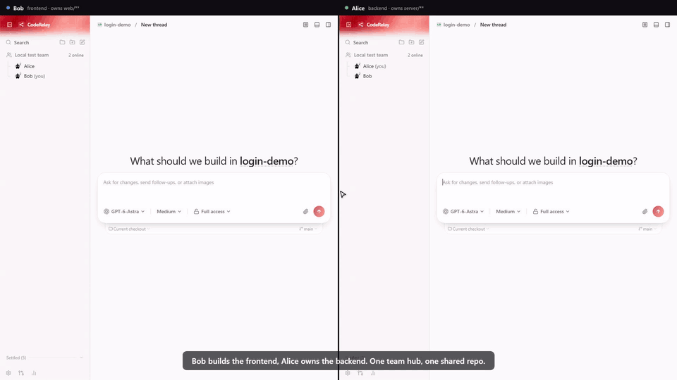

# CodeRelay

**Hand off work between your teammates' coding agents, with contracts pinned to Git commits.**

[Website](https://site-olive-two-79.vercel.app/) · [Download for Windows](https://github.com/AymanAhsan/CodeRelay/releases/download/main-latest/CodeRelay-windows-x64.exe) · [Quick start](#quick-start) · [Team hub guide](docs/user/team-hub.md)



<sub>Bob owns the frontend and Alice owns the backend. Bob's agent pushes an API contract and sends Alice a task. She accepts it into her own agent thread, and her agent returns the branch and commit. [Watch the full video](docs/assets/team-handoff.webm).</sub>

## Why

Agents on the same team step on each other's work: they edit the same files, duplicate tasks, or build against different assumptions about an API.

CodeRelay gives teammates a way to hand work between their agents. Each teammate declares the repository areas they own. When Alice's agent needs a change in Bob's area, it sends a task with a contract pinned to a Git commit. Bob reviews and accepts it into his own agent thread. Both agents work from the agreed contract, and the completed task carries a summary, branch, and commit back to Alice.

## Quick start

Install and authenticate a supported agent provider, such as Codex or Claude Code, before starting agent work.

### Install in one line

On Windows, in PowerShell, this downloads and runs the desktop installer:

```powershell
irm https://site-olive-two-79.vercel.app/install.ps1 | iex
```

On macOS or Linux, with **Node.js 24** and **Git** installed, this downloads CodeRelay into `~/CodeRelay`, installs Vite+ (`vp`) if needed, and installs dependencies:

```sh
curl -fsSL https://site-olive-two-79.vercel.app/install.sh | bash
```

Then start the demo with `cd ~/CodeRelay && vp run dev:team`. Set `CODERELAY_DIR` to install somewhere else.

### Install manually

Requires **Node.js 24**, **Git**, and **Vite+ (`vp`)**.

#### Install vp

On macOS or Linux:

```sh
curl -fsSL https://vite.plus | bash
```

On Windows, in PowerShell:

```powershell
irm https://vite.plus/ps1 | iex
```

### Try Alice and Bob locally

```sh
git clone https://github.com/AymanAhsan/CodeRelay.git
cd CodeRelay
vp i
vp run dev:team
```

The launcher starts a local Team hub and separate Alice and Bob sessions, with both teammates already joined. Open each session's labeled pairing URL from the terminal. Docker is not required for this demo.

1. Set each teammate's owned paths under **Your areas** in the Team hub panel.
2. Ask Alice's agent for work that needs a change in Bob's area. Have it push a contract and suggest a task for Bob.
3. In Bob's session, review the contract and accept the task to start his agent thread.
4. When Bob's agent finishes and marks the task done, review its summary, branch, and commit in Alice's session, then fetch and integrate the work.

Both local sessions share the selected project's files. To try a different repository with an `origin` remote, run `vp run dev:team --project-dir ../your-repo` instead. Press **Ctrl+C** in the launcher terminal to stop the demo.

See the [local demo guide](docs/operations/team-hub.md#local-development-with-alice-and-bob) for options, the [Team hub guide](docs/user/team-hub.md) for contract review and trusted automatic tasks, or [self-host a hub](docs/operations/team-hub.md) to connect real teammates. For a single session, run `vp run dev`; see the [development guide](docs/operations/development.md).

## Start a hub

A hub is required for real teammates to see each other and hand off tasks. Follow [Self-host a team hub](docs/operations/team-hub.md) to run one and share its address.

## Built on T3 Code

CodeRelay is built on [T3 Code](https://github.com/pingdotgg/t3code), which provides the agent GUI and web, desktop, and mobile foundations. This independently maintained repository adds the Team hub workflow for handing work between teammates' agents. The application currently retains upstream names and package identifiers; run CodeRelay from this checkout.

The original MIT license and **Copyright (c) 2026 T3 Tools Inc.** notice are preserved in [LICENSE](LICENSE). See [NOTICE.md](NOTICE.md) for attribution.
